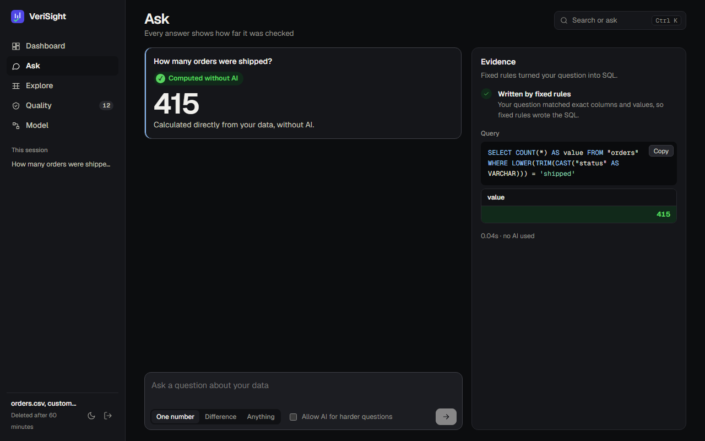
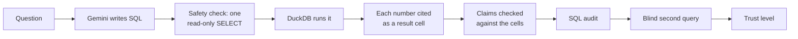
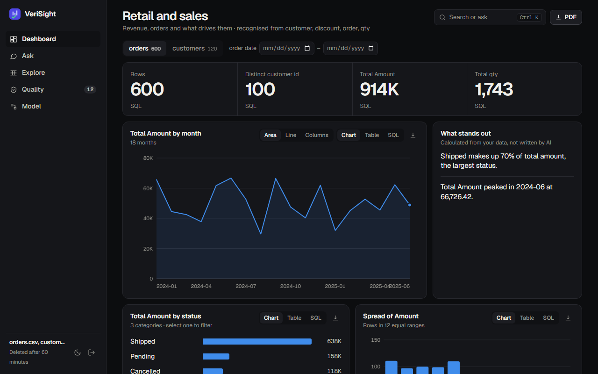

# VeriSight

**Ask questions about CSV, Excel and JSON files in plain English. An AI writes the
SQL, a database computes the answer, and VeriSight shows a number only when it can
trace it to the executed result.**

[](https://github.com/Md-Faiz-Alam/verisight/actions/workflows/ci.yml)




## Why

Ask a language model about a spreadsheet and it answers confidently, even when the
number is wrong or the data cannot answer the question. Asked for "the average
electricity price" when no column holds a price, it still gives a number.

VeriSight lets the model plan but never calculate. Every number must cite a cell of
an executed SQL result, the SQL is audited against the data, and a second, blind
query tries to reach the same number. Anything it cannot support is shown with a
warning, or not shown at all.

## How it works



Plainly worded questions, such as "How many orders were shipped?", skip the model:
fixed rules compile them to SQL. Questions the data cannot answer, or that use an
undefined word such as "large", are declined instead of guessed.

## Results

Two live runs on 60 questions whose data and answers are in the repository: the
[public benchmark](evaluation/benchmark) and [held-out set v4](evaluation/heldout_v4),
written after the first and never tuned against. Both compare VeriSight with Gemini
writing SQL alone, on the same cleaned data, prompt and model.

| Across 60 questions | Plain Gemini | VeriSight |
| --- | --- | --- |
| **Made-up or wrong numbers** | **12** | **0** |
| Questions with no valid answer, correctly refused (of 20) | 8 | 20 |
| Correct answers (of 40 answerable) | 40 | 37 |
| Median time per question | 10–17 s | 41–73 s |

On these generated files, plain Gemini answered every answerable question. Its
failure was confidence: given 20 questions the data cannot answer, it made up a
number for 12. VeriSight made up none. In ten earlier comparisons on public
datasets, plain Gemini gave 3 to 10 bad numbers per run, while VeriSight showed 0 to
2 prominently. The price is speed and cost: about 4 times slower, 4.5 times the
tokens, and a warning on 9 of its 37 correct answers.
[Live results](docs/results.md) has every run, including the misses.

## Quickstart

Windows PowerShell (on macOS or Linux, use `source .venv/bin/activate` and forward
slashes):

```powershell
git clone https://github.com/Md-Faiz-Alam/verisight.git
cd verisight
python -m venv .venv
.\.venv\Scripts\Activate.ps1
python -m pip install -e ".[web]"
verisight-web
```

Open <http://127.0.0.1:8000> and choose **Open the sample workspace**. The dashboard,
data-quality report and plain questions need no API key. For harder questions, paste
a free [Gemini API key](https://aistudio.google.com/apikey) on the page; it is used for
one question and never stored.



The website has five views: **Dashboard** (filter by clicking or by date), **Ask**
(an evidence panel for every answer), **Explore** (browse and search rows),
**Quality** (what was cleaned and what to check) and **Model** (how your files
connect). It is a FastAPI API, with interactive docs at `/docs`, and a React app that
loads nothing from outside your server. Each upload can be used only with the private
token returned to whoever uploaded it.

The same engine runs from the command line, here on the sample orders:

```powershell
verisight profile src\verisight\web\demo\orders.csv
verisight investigate src\verisight\web\demo\orders.csv --question "How many orders were shipped?" --allow-llm-data-disclosure --cross-check
```

`profile` never calls the model. `--allow-llm-data-disclosure` is required because
the schema, profile, question and result values are sent to Gemini. Set the key as
`VERISIGHT_GEMINI_API_KEY` in `.env`; every setting is listed in the
[guide](docs/guide.md#settings).

## Trust levels

| Level | Meaning |
| --- | --- |
| Computed without AI | Fixed rules wrote the SQL from exact column and value names. |
| Verified | The number equals its SQL result, the audit found nothing, and a second query agreed by a different route: other tables, row conditions, columns or structure. |
| Number matches SQL only | The number equals its SQL result, but a check could not run or the second query repeated the first one's choices. |
| Needs review | A check failed. The page says which one and why. |
| Not verified | No number could be tied to a result, or the question needs data or a definition the file lacks. No number is shown. |

The **SQL audit** checks each model-written query against the loaded rows for joins
that copy rows into a sum, totals counted twice, filter values the data lacks,
missing values counted as zero, the wrong column or calculation, and similar
mistakes. Offline, after one fix, it flagged no correct query and caught 18 of 30
held-out trap queries. The [guide](docs/guide.md#independent-cross-check) explains each check and
what counts as a different route.

## Limits

- A matched number came from an executed query; it does not prove the query means
  what the question asked. The audit and second query catch many such mistakes, not
  all.
- On the Gemini free tier, Google can use what is sent. Questions send column names
  and some values (the website at most 20 result rows per query). Use non-sensitive
  data only.
- One computer, no accounts; all questions so far were written on the project's own
  side. The [system specification](docs/system-spec.md) lists every limit and target.

## Documentation

| Page | What it covers |
| --- | --- |
| [Guide](docs/guide.md) | Settings, command line, Python API, cleaning rules and checks |
| [Architecture](docs/architecture.md) | How the parts fit together |
| [Live results](docs/results.md) | Every live evaluation, including failures |
| [System specification](docs/system-spec.md) | Supported input, limits, targets and their status |
| [Output contracts](docs/output-contracts.md) | What an accepted answer must contain |
| [Development](docs/development.md) | Checks, benchmarks and replays for contributors |
| [Deploy on Azure](docs/deploy-azure.md) | Publishing the website with Azure for Students |
| [Deploy on AWS](docs/deploy-aws.md) | Publishing the website on Amazon Lightsail |
| [Roadmap](docs/roadmap.md) | What is done and what comes next |

## Development

```powershell
python -m pip install -e ".[dev,web]"
python -m ruff check .
python -m mypy --strict src tests scripts
python -m pytest --cov=verisight --cov=scripts --cov-fail-under=100
```

CI runs these on Windows and Linux with no Gemini key, replays recorded model
responses through the whole pipeline, and runs the frontend's unit and browser tests.
See [Development](docs/development.md) for the full gate list.

## Dataset attribution

Development used Bank Marketing (Moro, S., Cortez, P., and Rita, P. (2014). *A
Data-Driven Approach to Predict the Success of Bank Telemarketing.* Decision Support
Systems, 62, 22–31; [UCI](https://archive.ics.uci.edu/dataset/222/bank+marketing)),
and other evaluations used public datasets from UCI, vega-datasets and seaborn-data.
Those are not in this repository; the public benchmark and held-out v4 data are
generated and included.

## License

MIT. See [LICENSE](LICENSE).
