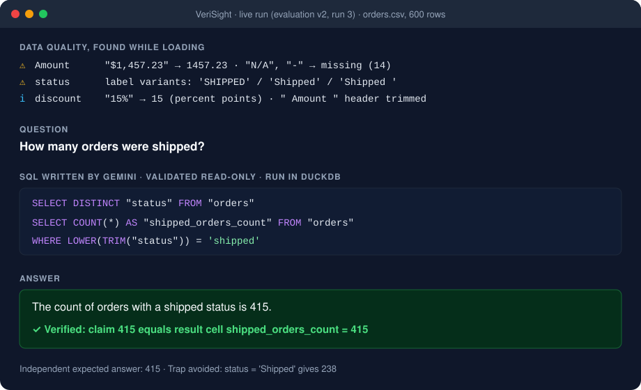

# VeriSight

**Ask questions about CSV, Excel and JSON files from any domain in plain English.
VeriSight answers with the SQL it ran, and accepts a number only when it matches
the query result.**

[](https://github.com/Md-Faiz-Alam/verisight/actions/workflows/ci.yml)




*From a live run ([evaluation v2](docs/results.md), run 3): VeriSight reports the
messy values it found while loading, Gemini writes the SQL, and the answer is
checked against the executed result.*

## Why VeriSight

- **Verified, not just generated.** Gemini plans the SQL and states each number
  as a claim on a result cell. VeriSight checks the claim against the executed
  query and refuses numbers it cannot support. On the website, a second query
  written without seeing the first must reach the same number before an answer
  is marked verified. When it cannot verify an answer, it says so instead of
  guessing.
- **Messy data handled in the open.** `N/A`, `$1,234.50`, `10%`, `Shipped ` /
  `shipped` and padded headers are cleaned under strict rules, and every change
  is reported as a data-quality finding.
- **Safe SQL.** One read-only statement over the loaded tables only: no file,
  network or settings access, with time, memory and result-size limits.
- **Measured honestly.** Every live run is published, failures included, and so
  are the places where Gemini writing SQL alone did better.

## Quickstart

Windows PowerShell (on macOS or Linux, use `source .venv/bin/activate` and
forward slashes):

```powershell
git clone https://github.com/Md-Faiz-Alam/verisight.git
cd verisight
python -m venv .venv
.\.venv\Scripts\Activate.ps1
python -m pip install -e .

# Create three messy demo files: no download, no AI
python evaluation\v2\run_v2_eval.py --prepare --data-dir demo --preflight-only

# Profile a file: schema, statistics and data-quality findings, no AI
verisight profile demo\orders.csv

# Ask a question: needs a free Gemini API key in .env
Copy-Item .env.example .env   # then set VERISIGHT_GEMINI_API_KEY=your-key
verisight investigate demo\orders.csv --question "How many orders were shipped?" --require-claim value --allow-llm-data-disclosure
```

`--allow-llm-data-disclosure` is required because the schema, profile, question
and observed values are sent to Gemini. `profile` and `--preview` never call the
model. Get a key from [Google AI Studio](https://aistudio.google.com/apikey).

## Website

VeriSight also runs as a website with five views: a Dashboard you can filter by
clicking or by date, Ask with an evidence panel for every answer, Explore for
browsing and searching rows, Quality for what was changed and what to check, and
Model for how your files connect. It is a FastAPI REST API with interactive docs
at `/docs`, plus a React app that loads nothing from outside your server.

The built app is committed under `src/verisight/web/static`, so running the website
needs only Python. To change the interface, install Node.js, then run these in
`frontend/`:

```powershell
npm install
npm run build
```

```powershell
python -m pip install -e ".[web]"
verisight-web
```

Then open <http://127.0.0.1:8000>. Visitors can paste their own Gemini key,
which is used for one question and never stored. To publish it, see
[Deploy on AWS](docs/deploy-aws.md).

## Live results

Every live run is published in [Live results](docs/results.md), failures included.

- **Against Gemini writing SQL alone**, on 30 questions the project owner wrote for
  4 unseen public datasets: VeriSight showed 1 bad number prominently, against 10
  for Gemini alone, and no wrong number on any answerable question. It delivered 15
  correct answers out of 20 against Gemini's 19, and put a warning on 4 correct
  answers.
- **A second comparison after fixes**, on 30 new questions and 4 new files: VeriSight
  showed 2 bad numbers prominently against Gemini's 8, delivered 18 correct answers
  against Gemini's 20, and warned on 6 correct answers. Both setups gave numbers on
  most questions that had no valid answer.
- **Earlier runs:** 150 development attempts gave 85 accepted answers, all correct.
  Held-out sets on unseen data first exposed 3 wrong accepted answers, which led to
  the SQL audit.

## Trust levels

Every website answer, and every command-line answer with `--cross-check`, carries
a trust level and the checks behind it:

| Level | Meaning |
| --- | --- |
| Computed without AI | Fixed rules wrote the SQL because the question matched exact columns and values. |
| Verified | The number equals its SQL result, the SQL audit found no known mistake, and a second query, written differently from the first, agreed. |
| Number matches SQL only | The number equals its SQL result, but a check could not run, or the second query only repeated the first. |
| Needs review | A check failed. The page says which one and why. |
| Not verified | No number could be tied to an executed result, the data does not hold what was asked, or the question needs a definition, such as what counts as "large". No number is shown. |

**Answers without AI.** Plainly worded questions, such as "What is the total amount
for East?" or "How many orders were shipped?", are compiled directly to SQL and need
no API key. When a value fits several columns, VeriSight asks which one you meant.
Anything else goes to the model-backed workflow.

**SQL audit.** Each model-written query is checked against the loaded rows, through
CTEs and subqueries, for joins that copy rows into a sum, totals counted twice, filter
values the column does not contain or only partly matches, values the question names
but the query skips, the wrong column or calculation, missing values counted as zero
or left in, a named year left out, thresholds such as "at least 5", percentages divided
down, and subtractions in the wrong order.

On the correct and trap queries of the evaluations, measured offline without a model,
the audit flagged no correct query after one fix and caught 24 of 37 development traps
and 18 of 30 held-out traps. Before that fix it wrongly flagged 1 held-out correct query.
The rules were written after reading the development traps, so the held-out figure is
the fairer one. Mistakes such as a wrong denominator or an unusual date boundary are not
caught by these rules, and no level proves an answer is right.

## Scope and limits

VeriSight runs on one computer; the [system specification](docs/system-spec.md)
lists its supported files, questions, limits and targets, with the status of each.

- A matched number shows that it came from an executed query, not that the query
  means what the question asked. The SQL audit and second query catch many such
  mistakes, but not all, and a second query can share the first one's mistake.
- On the Gemini free tier, Google can use what is sent to improve its products.
  Questions send column names, some values and up to 20 result rows per query,
  which for a small file can be all of it. Use non-sensitive data only.
- So far all testing was done by the project's own side.

## Documentation

| Page | What it covers |
| --- | --- |
| [Guide](docs/guide.md) | Command line, Python API, cleaning rules, investigations and verification |
| [System specification](docs/system-spec.md) | Supported input and questions, limits, data rule, targets and their status |
| [Live results](docs/results.md) | Every live evaluation, including failures |
| [Architecture](docs/architecture.md) | How the parts fit together |
| [Output contracts](docs/output-contracts.md) | What an accepted answer must contain |
| [Development](docs/development.md) | Setup, checks and evaluation for contributors |
| [Deploy on AWS](docs/deploy-aws.md) | Publishing the website |
| [Roadmap](docs/roadmap.md) | What is done and what comes next |

## Quality checks

```powershell
python -m ruff format --check .
python -m ruff check .
python -m mypy --strict src tests scripts
python -m pytest --cov=verisight --cov=scripts --cov-report=term-missing --cov-fail-under=100
git diff --check
```

The website has its own tests, run in `frontend/`:

```powershell
npm test
npm run test:e2e
```

[GitHub Actions](https://github.com/Md-Faiz-Alam/verisight/actions) runs these on
Windows and Linux with Python 3.11, without any Gemini key. Full coverage measures
the code that tests exercise, not accuracy.

## Dataset attribution

Development used Bank Marketing (Moro, S., Cortez, P., and Rita, P. (2014). *A
Data-Driven Approach to Predict the Success of Bank Telemarketing.* Decision Support
Systems, 62, 22–31; [UCI](https://archive.ics.uci.edu/dataset/222/bank+marketing)).
Other evaluations used public datasets from the UCI Machine Learning Repository,
vega-datasets and seaborn-data. Check each source's citation and licence before
redistributing. Datasets are not part of this repository.

## License

MIT. See [LICENSE](LICENSE).
