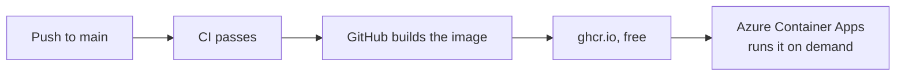

# Deploy the VeriSight website on Azure

This guide publishes the website on **Azure Container Apps** with an
[Azure for Students](https://azure.microsoft.com/free/students/) subscription, at
little or no cost. The site gets a free HTTPS address such as
`https://verisight.<random>.<region>.azurecontainerapps.io`.

You need neither Docker nor a paid registry. GitHub builds the image from this
repository after CI passes, and publishes it to GitHub Container Registry
(`ghcr.io`), which is free for public images. Azure only runs it.



## What it costs

| Piece | Cost |
| --- | --- |
| Image on `ghcr.io` (public) | Free |
| Container Apps environment (Consumption plan) | Free |
| The app, 0.5 CPU and 1 GB, stopped when nobody visits | Free within Azure's monthly allowance, then per second |

Each month, Container Apps includes 180,000 CPU-seconds and 360,000 GB-seconds
free. At 0.5 CPU and 1 GB, that is about **100 hours of running time a month**.
The app only runs while someone is using it and stops a few minutes later, so a
portfolio demo should stay inside the allowance. Check the current terms on the
[pricing page](https://azure.microsoft.com/pricing/details/container-apps/).

Three choices would spend your credit quickly, so this guide avoids them:

- **A paid Azure Container Registry.** Even the Basic tier is billed daily, about
  $5 a month, whether or not anyone visits.
- **Keeping the app always on** (`--min-replicas 1`). It would run all 720 hours of
  the month instead of only when used.
- **Log storage.** Logs are sent to a paid workspace by default; this guide turns
  that off.

## 1. Publish the image (on GitHub)

The workflow `.github/workflows/image.yml` runs after each successful CI run on
`main`. It can also be started by hand from the **Actions** tab: choose **Publish
image**, then **Run workflow**.

When it has finished once, make the image public, so that Azure can download it
without a password:

1. Open your GitHub profile, then **Packages**, then **verisight-web**.
2. Choose **Package settings**.
3. Under **Danger Zone**, choose **Change visibility**, then **Public**.

The run's summary page lists the tags it published: `latest` and one per commit,
such as `sha-1a2b3c4`.

## 2. Prepare the Azure CLI

Install the Azure CLI with `winget install -e --id Microsoft.AzureCLI`, close and
reopen PowerShell, then:

```powershell
az login
az extension add --name containerapp --upgrade
az provider register --namespace Microsoft.App --wait
```

`az login` opens a browser. If you have more than one subscription, choose
**Azure for Students**.

## 3. Create the app

```powershell
$rg = "verisight-rg"
$location = "centralindia"
az group create --name $rg --location $location
az containerapp env create --name verisight-env --resource-group $rg --location $location --logs-destination none
```

Azure for Students allows only a few regions. If a command fails with
`RequestDisallowedByAzure` or a policy error, the message lists the allowed
regions: set `$location` to one of them, delete the group with
`az group delete --name $rg --yes`, and start this step again.

```powershell
az containerapp create `
  --name verisight `
  --resource-group $rg `
  --environment verisight-env `
  --image ghcr.io/md-faiz-alam/verisight-web:latest `
  --target-port 8000 `
  --ingress external `
  --cpu 0.5 --memory 1.0Gi `
  --min-replicas 0 --max-replicas 1 `
  --env-vars `
    VERISIGHT_WEB_MAX_UPLOAD_MB=10 `
    VERISIGHT_MAX_EXCEL_UNCOMPRESSED_MB=100 `
    VERISIGHT_WEB_QUESTIONS_PER_HOUR=20 `
    VERISIGHT_WEB_MAX_CONCURRENT_QUESTIONS=1 `
    VERISIGHT_WEB_TRUST_FORWARDED_FOR=true
```

Get the address:

```powershell
az containerapp show --name verisight --resource-group $rg --query properties.configuration.ingress.fqdn --output tsv
```

Open `https://` followed by that address and click **Open the sample workspace**.
The first visit after a quiet spell takes about half a minute while the container
starts.

### Why these settings

- **One copy at most, none when idle** (`--min-replicas 0 --max-replicas 1`). Two
  copies would not share uploads. When the app stops, its uploads are gone, as they
  would be after an hour anyway.
- **1 GB of memory.** Peak memory measured with five 19.5 MB uploads and two
  questions at once was 781 MiB. Uploads are limited to 10 MB here, and one
  question runs at a time, to leave room.
- **Visitor addresses** (`VERISIGHT_WEB_TRUST_FORWARDED_FOR=true`). Container Apps'
  proxy adds the visitor's address to `X-Forwarded-For`, and rate limits use the
  last entry. Leave this off anywhere no such proxy sits in front of the app,
  because a visitor could then forge the header to dodge the limits.
- **No log storage** (`--logs-destination none`). Live output is still available
  with `az containerapp logs show --name verisight --resource-group $rg --follow`.

Every setting is listed in the [guide](guide.md#settings).

## 4. Set a budget alert

In the [Azure portal](https://portal.azure.com), open **Cost Management**, then
**Budgets**, and add a monthly budget of, say, $2 with an email alert at 50%. If
anything starts costing money, you hear about it within a day, long before the
credit is gone. Your remaining credit is shown at
[Azure for Students](https://www.microsoftazuresponsorships.com/Balance).

## The Gemini key

By default the site has **no server key**: each visitor pastes their own Gemini
key, which is used for that question only and never stored or logged. This costs
you nothing in Gemini quota and is the safest choice for a public site.

To let visitors ask without a key, store yours as a secret and point the setting
at it:

```powershell
az containerapp secret set --name verisight --resource-group $rg --secrets gemini-key=YOUR-KEY
az containerapp update --name verisight --resource-group $rg --set-env-vars VERISIGHT_GEMINI_API_KEY=secretref:gemini-key
```

Every visitor then uses your quota, so keep `VERISIGHT_WEB_QUESTIONS_PER_HOUR` low.
Never put the key in the Dockerfile, the image or Git.

## Update the site

Push to `main`. When CI and **Publish image** have passed, take the new commit tag
from that run's summary and deploy it:

```powershell
az containerapp update --name verisight --resource-group $rg --image ghcr.io/md-faiz-alam/verisight-web:sha-1a2b3c4
```

Use the commit tag rather than `latest`: Azure starts a new version only when the
image name changes.

## Stop paying

Deleting the resource group removes the app and its environment:

```powershell
az group delete --name $rg --yes --no-wait
```

The image on `ghcr.io` costs nothing and can stay.

## Test the image on your computer (optional)

With Docker Desktop running:

```powershell
docker run --rm -p 8000:8000 ghcr.io/md-faiz-alam/verisight-web:latest
```

Then open <http://localhost:8000>. The same image also runs on AWS; see
[Deploy on AWS](deploy-aws.md).
