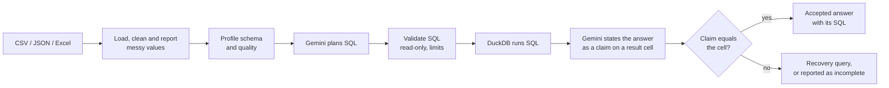

# Live results

VeriSight answers questions about tabular data from any domain by writing SQL,
running it, and accepting a number only when that number is found in the SQL
result. This page reports every live run of its three evaluations, including
failures. No run was repeated to replace a worse one.

## At a glance

| | |
| --- | --- |
| Live attempts | **150** |
| Answers VeriSight accepted | **85** |
| Accepted answers that were wrong | **0** |
| Attempts that ended without an accepted number | 13 (VeriSight reported this rather than guessing) |
| Attempts lost to the model provider (HTTP 503/500) | 52 |
| Domains | 7: banking, transport, ecology, gem retail, e-commerce orders, customer records, energy sensors |
| File formats | CSV, JSON, Excel |
| Model | `gemini-3.1-flash-lite` (free tier), Python 3.11.9, `google-genai` 2.27.0 |

"Wrong" means a number VeriSight accepted that differs from an expected answer
computed independently, from the source data, without VeriSight, pandas or
DuckDB. Attempts lost to the provider are listed but are not counted for or
against VeriSight.

## How an answer is produced and checked



Gemini never supplies a final number on its own. Each number must cite a cell of
an executed query, and the verifier compares the two exactly (see
[Verification and narrative audit](../README.md#verification-and-narrative-audit)).

## Evaluations

Each question has an independently computed answer, a correct control SQL that
must reproduce it, and a plausible trap SQL that must give a different number.
An offline preflight checks all three before any model call. Questions were
frozen before their first live run. VeriSight's code contains nothing specific
to these datasets.

### Bank marketing (CSV, 10 questions)

The UCI bank marketing dataset (41,188 rows): subscription rates, shares among
known values, a minimum group size, and a difference of two rates.

| Run | Revision | Correct | No accepted number | Provider errors |
| --- | --- | --- | --- | --- |
| 1 | `0cd7d6f` | 6 | 4 (2 incomplete, 2 claims rejected) | 0 |
| 2 | `2bab3a7` | 7 | 3 (1 incomplete, 2 claims rejected) | 0 |
| 3 | `8b0ddf3` | **10** | 0 | 0 |

Runs 1 and 2 found gaps in population review (wording such as "as a single
number" was read as part of the question's population) and in claim checking
(a final value missing from the evidence). Both were fixed before run 3, in
`5feaffe` and `8b0ddf3`.

### Multidomain v1 (13 questions, 3 formats)

Public datasets from one pinned seaborn-data commit, each converted to a
different format: NYC taxi trips as JSON (6,433 rows, missing values as null),
Palmer penguins as Excel (344 rows, empty cells) and diamonds as CSV (53,940
rows). Questions cover subset means, null counts, medians with two filters,
differences of means and conditional shares.

| Run | Revision | Correct | No accepted number | Provider errors |
| --- | --- | --- | --- | --- |
| 1 | `97abd60` | 4 | 1 incomplete | 8 |
| 2 | `6b6e411` | 8 | 3 incomplete | 2 |
| 3 | `8594395` | **13** | 0 | 0 |
| 4 | — | — | stopped before the first question | — |
| 5 (×3) | `e80334b` | 10 | 0 | 29 |

Run 2 found that correct conclusions were refused when they mentioned labels
such as `VVS1` or rounded displays; this was fixed before run 3. Run 5 repeated
all questions three times during a provider outage: every attempt not lost to
the provider was correct.

### Evaluation v2: messy values, dates and joins (14 questions)

Three files generated from a fixed seed, identical on every machine:
`orders.csv` with `$1,234.50`, `N/A`, `-`, `10%`, `Shipped` / `shipped ` /
`SHIPPED` and a padded header; `customers.xlsx`, joined to orders, where region
`NA` means North America; and `sensors.json` with ISO date-times and kWh
numbers mixed with `"N/A"` text.

| Run | Revision | Correct | No accepted number | Provider errors |
| --- | --- | --- | --- | --- |
| 1 | `3a06716` | 4 | 0 | 10 |
| 2 | `3a06716` | 11 | 2 (1 incomplete, 1 claim rejected) | 1 |
| 3 | `2d599eb` | **12** | 0 | 2 |

Every one of the 14 questions has been answered correctly at least once. Run 2
found that a correct sum, `333819.64`, was refused because the SQL cell held
binary floating-point noise, `333819.64000000036`; this was fixed before run 3.

### Totals

| Evaluation | Attempts | Correct | Wrong | No accepted number | Provider errors |
| --- | --- | --- | --- | --- | --- |
| Bank marketing | 30 | 23 | 0 | 7 | 0 |
| Multidomain v1 | 78 | 35 | 0 | 4 | 39 |
| Evaluation v2 | 42 | 27 | 0 | 2 | 13 |
| **All** | **150** | **85** | **0** | **13** | **52** |

## Examples from live runs

**Label variants (v2 run 3).** *How many orders were shipped?* The status column
holds `Shipped`, `shipped`, `SHIPPED` and `Shipped `. Gemini first listed the
distinct values, then counted:

```sql
SELECT COUNT(*) AS "shipped_orders_count" FROM "orders"
WHERE LOWER(TRIM("status")) = 'shipped'
```

Answer **415**, correct. The trap, `status = 'Shipped'`, gives 238.

**A two-file join where `NA` is a label (v2 run 3).** *What is the total amount
of orders placed by customers in the NA region?* `Amount` arrived as text such
as `$1,234.50`; VeriSight converted it and reported the conversion as a
data-quality finding. `NA` stayed a region label, while blank regions became
missing.

```sql
SELECT SUM("T1"."Amount") FROM "orders" AS "T1"
JOIN "customers" AS "T2" ON "T1"."customer_id" = "T2"."customer_id"
WHERE "T2"."region" = 'NA'
```

Answer **333819.64**, correct. The trap, treating `NA` as missing, gives 60199.97.

**Recovery instead of a guess (v2 run 3).** *How many days passed between the
first and the last order date?* Gemini's first query returned only the two
dates. No claim could cite a cell holding the number of days, so VeriSight ran
one recovery query:

```sql
SELECT date_diff('day', MIN("order_date"), MAX("order_date"))
  AS "days_between_first_and_last_order" FROM "orders"
```

Answer **546**, correct. The trap, counting days that have orders, gives 379.

**Nulls (multidomain run 3).** *How many taxi trips have no recorded payment
method?* `SELECT COUNT(*) FROM "taxis" WHERE "payment" IS NULL` returned
**44**, correct. The trap, `payment NOT IN ('cash', 'credit card')`, gives 0
because `NOT IN` never matches null.

## What these results do and do not show

- An accepted number is proven to come from an executed SQL result. The
  verifier does not prove that the SQL means what the question asked. The
  evaluations measure that separately, against independent answers and traps.
- These are development evaluations with known questions, not a held-out
  benchmark. Gaps they found were fixed between runs, as the tables show.
- v2 data is generated, not collected; it reproduces common real-world problems
  but not every one. Formats outside the documented cleaning rules stay as text.
- Provider errors depend on the free model tier's load and are excluded from the
  correct and wrong counts, not hidden: they appear in every table.
- 150 attempts across 37 questions is evidence, not a reliability guarantee.

## Reproduce

```powershell
python evaluation\bank\run_bank_eval.py --dataset datasets\bank_marketing\bank-additional-full.csv --preflight-only
python evaluation\multidomain\run_multidomain_eval.py --prepare --data-dir datasets\multidomain --preflight-only
python evaluation\v2\run_v2_eval.py --prepare --data-dir datasets\v2 --preflight-only
```

Remove `--preflight-only` and add a new `--out` folder outside the repository to
run live. Each run writes a manifest (revision, packages, settings, questions,
expected and trap values), one JSON report per attempt and a summary.

Correct and wrong count only answers VeriSight accepted. A matching SQL cell
inside a rejected answer is scored `not_accepted`, never correct. To rescore a
saved run with the current scorer, without model calls and without changing the
run folder:

```powershell
python evaluation\rescore.py evaluation\v2\run_v2_eval.py <run folder> --out <new folder>
```
